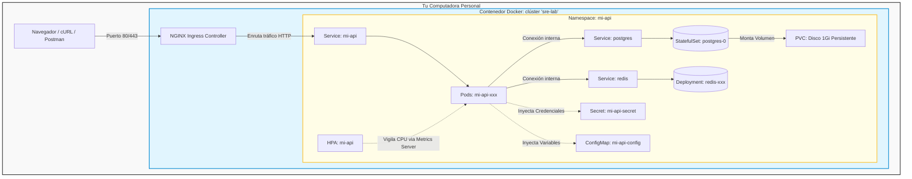

# Plataforma DevOps - Laboratorio Kubernetes con Kind

Este repositorio contiene la configuración automatizada para desplegar una arquitectura microservicios local utilizando **Kubernetes (Kind)**, que incluye una API personalizada, una base de datos persistente (**PostgreSQL**), una caché (**Redis**) y escalabilidad automática (**HPA**), todo expuesto al exterior mediante un **NGINX Ingress Controller**.

---

## 🏗️ Arquitectura del Sistema

El siguiente diagrama muestra la estructura de "muñecas rusas" (capas de contenedorización) y el flujo de red desde tu máquina física hasta los componentes internos del clúster:



---

## 🚀 Cómo Levantar el Laboratorio

El proyecto utiliza un `Makefile` para automatizar todo el ciclo de vida del entorno. Ejecuta los comandos en orden desde tu terminal:

### 1. Preparar el Terreno
Levanta el clúster de Kind e instala automáticamente el controlador de Ingress de NGINX:
```bash
make up
```

### 2. Inyectar tu Aplicación Local
Si compilas la imagen de tu API localmente, debes cargarla dentro del edificio de Kind para que Kubernetes pueda verla:
```bash
# Ejemplo tras compilar tu imagen como mi-api:1.0.1
kind load docker-image mi-api:1.0.1 --name sre-lab
```

### 3. Desplegar la Infraestructura
Aplica de golpe todos los archivos de configuración (Secret, ConfigMap, Postgres, Redis, API, HPA):
```bash
make deploy
```

### 4. Limpiar y Destruir
Cuando termines de trabajar, libera la memoria RAM y los puertos de tu computadora borrando el clúster por completo:
```bash
make down
```

---

## 📦 Tabla de Objetos de Kubernetes

| Objeto | Nombre | Tipo de Recurso | Propósito / Función |
| :--- | :--- | :--- | :--- |
| **Namespace** | `mi-api` | Virtual Folder | Aísla lógicamente nuestra aplicación y sus recursos del resto del clúster. |
| **Secret** | `mi-api-secret` | Opaque Secret | Guarda de forma segura la contraseña (`POSTGRES_PASSWORD`) codificada en Base64. |
| **ConfigMap** | `mi-api-config` | ConfigMap | Almacena variables de entorno globales no confidenciales (ej. usuarios, nombres de BD). |
| **StatefulSet** | `postgres` | StatefulSet | Controla el pod de la Base de Datos garantizando una identidad fija y persistencia. |
| **PersistentVolumeClaim** | `data` | Storage Claim | Reserva un disco duro virtual real de `1Gi` para que las tablas de Postgres no se borren. |
| **Deployment** | `mi-api` | Deployment | Molde que administra los pods sin estado de nuestra aplicación web. |
| **Deployment** | `redis` | Deployment | Levanta y mantiene activa la instancia de caché para optimizar las consultas. |
| **Service** | `postgres` / `redis` / `mi-api` | ClusterIP Service | Crean antenas/IPs internas fijas para que los microservicios se comuniquen por sus puertos nativos. |
| **HPA** | `mi-api` | HorizontalPodAutoscaler | El piloto automático que clona o destruye pods de la API según la demanda de CPU. |

---

## 🔬 Sección de Experimentos y Observaciones

Durante las pruebas de estrés y resiliencia en este laboratorio, se validaron las tres características clave de Kubernetes: **Auto-sanación, Escalabilidad Automatizada y Persistencia**.

### Experimento 1: Simulación de Ataque con Tráfico Pesado (Autoscaling)
* **Comando ejecutado:** Un bucle infinito con un pod temporal de `busybox` atacando el endpoint de visitas:
  ```bash
  kubectl -n mi-api run load --rm -it --image=busybox -- sh -c "while true; do wget -q -O- http://mi-api/visits; done"
  ```
* **Observación de Consumo:** La CPU del pod de la API se disparó instantáneamente hasta el **200%**. 
* **Análisis Técnico:** En Kubernetes, el 100% representa el valor del `requests.cpu` (`100m`). Al haber picos altos, el contenedor usó el excedente permitido por su límite de emergencia (`limits.cpu: 500m`). La aplicación **nunca crasheó** gracias a esta holgura de hardware.
* **Comportamiento del HPA:** Al superar el umbral del 50% configurado, el HPA reaccionó con éxito clonando el despliegue de **2 a 4 pods en total**, distribuyendo la carga de red.
* **Efecto Post-Ataque:** Tras detener el tráfico, los 4 pods permanecieron activos temporalmente. Esto se debe al *Cool-down Period* de Kubernetes, que espera **5 minutos** antes de reducir réplicas para evitar inestabilidad (bamboleo).

### Experimento 2: Simulación de Caída Total de la Base de Datos
* **Comando ejecutado:** Forzar el apagado manual del StatefulSet reduciendo sus réplicas a cero:
  ```bash
  kubectl -n mi-api scale statefulset postgres --replicas=0
  ```
* **Comportamiento de la API:** Al ejecutar `kubectl get pods`, las instancias de `mi-api` pasaron automáticamente de `1/1 READY` a **`0/1 READY`**, pero su estado continuó en `Running` (no se reiniciaron en bucle).
* **Análisis Técnico:** El *Readiness Probe* de la API detectó que la base de datos no respondía y se declaró "No Disponible". Al consultar el endpoint `localhost:8081/ready`, el clúster arrojó un código **HTTP 503**, aislando los pods para que los usuarios finales no reciban errores internos de conexión.
* **Validación de Persistencia:** Al restaurar la base de datos con `scale --replicas=1`, el nuevo pod `postgres-0` heredó inmediatamente el volumen de almacenamiento de `1Gi`. Los datos de las tablas se mantuvieron intactos y la API volvió automáticamente a `1/1 READY`.

### Experimento 3: Destrucción Directa de un Pod (Auto-sanación)
* **Comando ejecutado:** Eliminación manual de la base de datos viva:
  ```bash
  kubectl -n mi-api delete pod postgres-0
  ```
* **Observación:** El pod se destruyó, pero **nació uno nuevo idéntico llamado `postgres-0` en menos de dos segundos**.
* **Diferencia Clave con `scale`:** A diferencia de `scale --replicas=0` (donde le indicamos a Kubernetes que el estado deseado era cero pods), el comando `delete pod` generó un accidente simulado. Como la configuración base del StatefulSet seguía exigiendo 1 réplica, el clúster ejecutó su protocolo de auto-sanación instantánea para corregir el desajuste.
